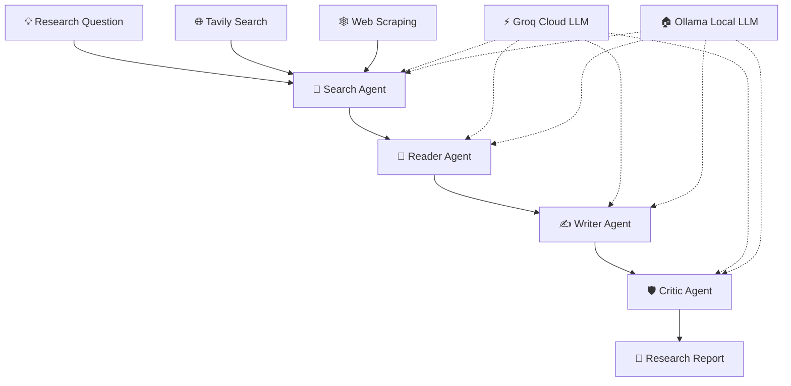

# 🧠 AI Research Studio
### Your AI-powered research team — search, analyze, write, and refine.

<p align="center">
  <strong>A multi-agent AI research system that transforms a research question into a structured, comprehensive report.</strong>
</p>

<p align="center">
  <a href="https://github.com/PriyankV25/ai-research-studio">
    
  </a>
  
  
  
</p>

---

## ✨ What is AI Research Studio?

AI Research Studio is an open-source, multi-agent AI application designed to make research more accessible and efficient.

Instead of relying on a single AI response, the application organizes research into specialized stages. Agents collaborate to gather information, analyze relevant content, generate a report, and review the result.

Use a hosted LLM through **Groq** or run a compatible open-weight model locally using **Ollama**.

🎯 **The goal:** Turn a simple research topic into a useful, structured report with less manual effort.

## 🚀 Key Features

| Feature | Description |
|---|---|
| 🔎 Search Agent | Finds relevant web information using the configured search tools. |
| 📖 Reader Agent | Processes retrieved content and extracts useful insights. |
| ✍️ Writer Agent | Organizes research into a readable report. |
| 🛡️ Critic Agent | Reviews the generated report and suggests improvements. |
| 🤖 Multi-agent workflow | Separates research responsibilities into specialized stages. |
| ⚡ Groq integration | Uses cloud-hosted language models for inference. |
| 🏠 Ollama support | Enables local inference with compatible open-weight models. |
| 🌐 Web interface | Provides a convenient interface for submitting research topics and viewing results. |
| 📊 Workflow visibility | Designed to make the research process easier to follow. |
| ☁️ Cloud deployment | Can be deployed to Render using the repository's deployment configuration. |
| 🧩 Extensible architecture | Offers a foundation for adding agents, tools, and model providers. |

> Feature availability depends on the current implementation and configuration in the repository.

## 🧭 How It Works



### The four research stages

1. **Search:** Gather relevant information from web sources.
2. **Read:** Analyze retrieved material and identify important findings.
3. **Write:** Turn the findings into a structured research report.
4. **Critique:** Review the report for clarity, relevance, and quality.

The generated report should still be checked against its original sources. AI-generated content can contain inaccuracies, incomplete citations, or outdated information.

## 🛠️ Technology Stack

| Technology | Purpose |
|---|---|
| Python | Core application logic |
| Flask | Web application backend |
| HTML, CSS and JavaScript | Frontend interface |
| LangChain | LLM integration and agent components |
| LangGraph | Workflow orchestration, if enabled in the implementation |
| Groq | Cloud LLM inference |
| Ollama | Local model inference |
| Tavily | Web search |
| BeautifulSoup | HTML parsing and web-content extraction |
| Git and GitHub | Version control and collaboration |
| Render | Cloud application hosting |

## 📋 Prerequisites

Before starting, install or obtain the following:

- **Python 3.12 recommended** for a broadly compatible development environment.
- **Git** to clone and manage the repository.
- A code editor such as Visual Studio Code.
- A **Groq API key** for cloud inference, available through the [Groq Console](https://console.groq.com/).
- A **Tavily API key** for web search, available through [Tavily](https://tavily.com/).
- **Ollama** (optional) if you want to run supported models locally.
- A **Render account** if you want to deploy the application online.

You do not need Ollama if you plan to use Groq exclusively. Likewise, local development does not require a Render account.

## ⚡ Quick Start — Windows

### 1. Clone the repository

Open PowerShell or Git Bash:

```bash
git clone https://github.com/PriyankV25/ai-research-studio.git
cd ai-research-studio
```

### 2. Create a virtual environment

**PowerShell:**

```powershell
py -3.12 -m venv .venv
.\.venv\Scripts\Activate.ps1
```

**Git Bash:**

```bash
py -3.12 -m venv .venv
source .venv/Scripts/activate
```

If Python 3.12 is not installed, install it first or use another Python version supported by the project's dependencies.

### 3. Install dependencies

```bash
python -m pip install --upgrade pip
pip install -r requirements.txt
```

### 4. Configure environment variables

Create your local environment file from the example:

**PowerShell:**

```powershell
Copy-Item .env.example .env
```

**Git Bash:**

```bash
cp .env.example .env
```

Edit `.env` with your preferred model provider and API credentials.

```dotenv
# LLM Provider: groq or ollama
LLM_PROVIDER=groq

# Groq cloud configuration
GROQ_API_KEY=your_groq_api_key
GROQ_MODEL=openai/gpt-oss-120b

# Tavily web search
TAVILY_API_KEY=your_tavily_api_key

# Optional Ollama configuration
OLLAMA_BASE_URL=http://localhost:11434
OLLAMA_MODEL=qwen3:8b
```

**Important:** The model ID shown above is an example. Use a model currently available to your Groq account. The `.env` file must remain private and must never be committed to GitHub.

### 5. Start the application

```bash
python app.py
```

Open the local address shown by the application. If it uses Flask's default development port, try:

http://127.0.0.1:5000

For local development, use Flask's development server. Do not expose it directly to the public internet.

---

## ⚡ Choose Your AI Model Provider

AI Research Studio supports two model-running approaches through its provider configuration.

### Option A — Groq cloud inference

Groq runs supported language models through a hosted API. Your application sends model requests to Groq, so you do not need to download large model files to your computer.

**Setup**

1. Create an account at [Groq Console](https://console.groq.com/).
2. Generate an API key.
3. Add the key to your `.env` file.
4. Set the provider to `groq`.
5. Choose an available model ID.

```dotenv
LLM_PROVIDER=groq
GROQ_API_KEY=your_groq_api_key
GROQ_MODEL=openai/gpt-oss-120b
```

**Advantages**

- No large local model download.
- Convenient for hosted deployments.
- Model inference runs on the provider's infrastructure.
- Suitable for experimenting with multi-agent workflows.

API availability, model access, usage limits, and pricing depend on the provider and your account.

### Option B — Ollama local inference

[Ollama](https://ollama.com/) lets you run supported open-weight models on your own computer. This can reduce dependence on a cloud LLM API, although local hardware and model licenses still matter.

**1. Install Ollama**

Download and install it from [ollama.com](https://ollama.com/).

**2. Download a model**

For example:

```bash
ollama pull qwen3:8b
```

**3. Verify that the model is available**

```bash
ollama list
```

**4. Update `.env`**

```dotenv
LLM_PROVIDER=ollama
OLLAMA_BASE_URL=http://localhost:11434
OLLAMA_MODEL=qwen3:8b
TAVILY_API_KEY=your_tavily_api_key
```

**5. Run the application**

```bash
python app.py
```

Make sure Ollama is running and the selected model supports the features required by the application. In particular, agent workflows that use tools may require a model with compatible tool-calling support.

**What about privacy?** Local inference can keep prompts sent to the LLM on your machine. However, if you use Tavily or other online tools, the search requests and information sent to those services are still processed externally.

### Groq vs. Ollama

| Consideration | Groq | Ollama |
|---|---|---|
| Where inference runs | Cloud | Your configured Ollama machine or server |
| Model download | Not required locally | Required |
| API key | Groq API key | Not normally required for local Ollama |
| Hardware requirements | Primarily network access | Depends on model size and available hardware |
| Internet access | Required | Not required for local inference itself; online research tools still need internet |
| Cloud deployment | Convenient | Requires a reachable Ollama service if the app is hosted remotely |

## ☁️ Deploy on Render

Render can host the Flask application and make it accessible through a public URL.

### Step 1 — Push your project to GitHub

Ensure the latest application code, dependency file, and deployment configuration are committed.

```bash
git add .
git commit -m "Prepare AI Research Studio for deployment"
git push origin main
```

Before pushing, verify that `.env`, `.venv`, and any private credentials are excluded by `.gitignore`.

### Step 2 — Create a Blueprint

1. Sign in to [Render](https://render.com/).
2. Open the dashboard.
3. Select **New → Blueprint**.
4. Connect your GitHub account if needed.
5. Choose `PriyankV25/ai-research-studio`.
6. Give the Blueprint a name, such as `ai-research-studio`.
7. Review the services and configuration Render discovers from `render.yaml`.
8. Apply the configuration.

### Step 3 — Configure environment variables

Open the service's environment settings and add:

| Variable | Value |
|---|---|
| `LLM_PROVIDER` | `groq` |
| `GROQ_API_KEY` | Your actual Groq API key |
| `GROQ_MODEL` | A currently supported Groq model ID |
| `TAVILY_API_KEY` | Your actual Tavily API key |

Use Render's secret/environment-variable settings rather than committing credentials to your repository.

### Step 4 — Verify the deployment configuration

For a Flask app whose entry point is `app.py` and whose Flask object is named `app`, a Linux-based Render service can use a Gunicorn start command such as:

```bash
gunicorn app:app --workers 1 --threads 8 --timeout 180
```

Ensure `gunicorn` is listed in `requirements.txt` and that the Flask application is configured for Render's runtime environment. Keep any local `app.run()` development code inside an `if __name__ == "__main__":` block.

If your repository already includes a working `render.yaml`, use its configured start command instead of adding conflicting settings.

### Step 5 — Test your live application

After the service reports **Live**:

- Open the public `.onrender.com` URL.
- Confirm that the frontend loads.
- Submit a research question.
- Check the service logs if a research request fails.
- Verify that the required environment variables and model access are configured correctly.

### Important: Ollama and Render

Setting `OLLAMA_BASE_URL=http://localhost:11434` on Render does **not** connect to Ollama running on your personal computer. In a hosted service, `localhost` refers to the hosted service's own environment.

For a straightforward public deployment, use Groq as the default provider. To use Ollama remotely, you must separately host Ollama on a reachable machine or service and configure a secure, accessible endpoint. Never expose an unauthenticated Ollama API publicly.

Render's available plans, resource limits, sleep behavior, and pricing can change; check the current [Render documentation](https://render.com/docs) before choosing a plan.

## 🔐 Security Best Practices

- Never commit `.env`, API keys, access tokens, or other secrets.
- Keep `.env.example` populated with placeholder values only.
- Store production secrets in Render's environment settings.
- Avoid logging API keys or sensitive prompts.
- Validate user input before sending it to agents or external tools.
- Treat scraped web pages as untrusted input.
- Restrict outbound access and protect any remotely exposed model endpoint.
- Review the licensing and terms of each model and external service you use.

If a real API key is accidentally pushed to a public repository, revoke or rotate it immediately. Removing it from the latest commit alone does not erase it from Git history.

## 🧩 Open Source & Contributions

AI Research Studio is intended to be an open-source learning and development project. Contributions that improve reliability, usability, research quality, model compatibility, accessibility, and documentation are welcome.

### Ways to contribute

- 🐛 Report a bug or unexpected agent behavior.
- 💡 Suggest a feature or a new research workflow.
- 🤖 Add support for another LLM provider.
- 🔧 Improve tool calling, error handling, or performance.
- 🎨 Improve the interface and responsive design.
- 📚 Improve setup instructions and examples.
- 🧪 Add tests and reproducible evaluation cases.

### Contribution workflow

1. Fork this repository.
2. Create a feature branch.
3. Implement and test your changes.
4. Commit with a descriptive message.
5. Push your branch and open a Pull Request.

```bash
git checkout -b feature/your-improvement
git add .
git commit -m "Add your improvement"
git push origin feature/your-improvement
```

Please include clear reproduction steps when reporting bugs and never include API keys in issues or pull requests.

### Licensing

To make the repository officially open-source, add a `LICENSE` file at the repository root. The MIT License is one option if you want to allow broad reuse, modification, and redistribution while preserving the copyright and license notice.

Before selecting a license, verify that the code and any bundled assets you distribute are yours to license. Model weights, external libraries, APIs, and third-party assets may have separate terms.

## 🗺️ Roadmap Ideas

Potential improvements for future contributors:

- [ ] Export reports to Markdown and PDF.
- [ ] Display research sources and citations alongside findings.
- [ ] Add research history and report comparison.
- [ ] Support configurable agent workflows.
- [ ] Add tests for agent outputs and tool failures.
- [ ] Improve streaming progress and cancellation.
- [ ] Add configurable model selection through the UI.
- [ ] Add evaluation metrics for source quality and report consistency.

These are proposed improvements, not a claim that every feature is already implemented.

## 🧯 Troubleshooting

<details>
<summary><strong>Groq model unavailable or API error</strong></summary>

Check that your API key is valid, the requested model ID is currently supported by your account, and you have not exceeded provider limits. Update `GROQ_MODEL` if necessary.

</details>

<details>
<summary><strong>Ollama connection refused</strong></summary>

Ensure Ollama is installed and running, the model has been downloaded, and `OLLAMA_BASE_URL` points to the correct reachable endpoint. Local inference normally uses `http://localhost:11434`.

</details>

<details>
<summary><strong>Missing Python package</strong></summary>

Activate your virtual environment and reinstall the project dependencies:

```bash
python -m pip install -r requirements.txt
```

If installation fails, review the full error and use a Python version compatible with the project's dependency set.

</details>

<details>
<summary><strong>Render build or startup failure</strong></summary>

Inspect the Render build and runtime logs. Check `requirements.txt`, the Flask entry point, the configured start command, required environment variables, and the availability of the selected model.

</details>

<details>
<summary><strong>Research workflow fails after the page loads</strong></summary>

A working frontend does not guarantee that the research backend is configured correctly. Check your LLM and Tavily credentials, provider limits, network access, scraping errors, and the server logs.

</details>

## 🌟 Support the Project

If you find AI Research Studio useful:

- ⭐ Star the repository.
- 🍴 Fork it and experiment with your own agents.
- 🐛 Report issues and suggest improvements.
- 🤝 Contribute features and documentation.
- 📣 Share the project with other AI builders.

<p align="center">
  <strong>Built for curious minds and developers who want to make research smarter.</strong>
  <br>
  Explore. Analyze. Create. Improve.
</p>

<p align="center">
  <a href="https://github.com/PriyankV25/ai-research-studio">View on GitHub</a>
</p>
