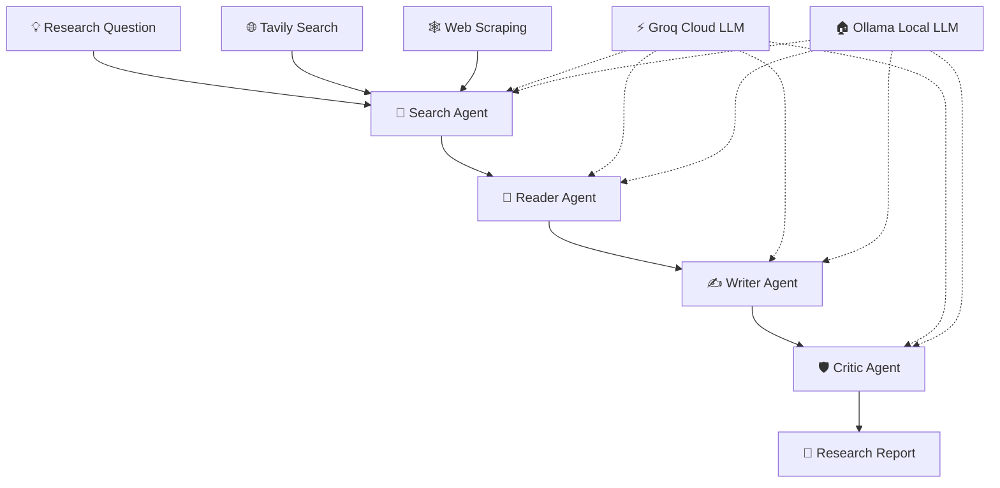

# 🧠 AI Research Studio
### Your AI-powered research team — search, analyze, write, and refine.

<p align="center">
  <strong>A multi-agent AI research system that transforms a research question into a structured, comprehensive report.</strong>
</p>

<p align="center">
  <a href="https://github.com/PriyankV25/ai-research-studio">
    
  </a>
  
  
  
</p>

---

## ✨ What is AI Research Studio?

AI Research Studio is an open-source, multi-agent AI application designed to make research more accessible and efficient.

Instead of relying on a single AI response, the application organizes research into specialized stages. Agents collaborate to gather information, analyze relevant content, generate a report, and review the result.

Use a hosted LLM through **Groq** or run a compatible open-weight model locally using **Ollama**.

🎯 **The goal:** Turn a simple research topic into a useful, structured report with less manual effort.

## 🚀 Key Features

| Feature | Description |
|---|---|
| 🔎 Search Agent | Finds relevant web information using the configured search tools. |
| 📖 Reader Agent | Processes retrieved content and extracts useful insights. |
| ✍️ Writer Agent | Organizes research into a readable report. |
| 🛡️ Critic Agent | Reviews the generated report and suggests improvements. |
| 🤖 Multi-agent workflow | Separates research responsibilities into specialized stages. |
| ⚡ Groq integration | Uses cloud-hosted language models for inference. |
| 🏠 Ollama support | Enables local inference with compatible open-weight models. |
| 🌐 Web interface | Provides a convenient interface for submitting research topics and viewing results. |
| 📊 Workflow visibility | Designed to make the research process easier to follow. |
| ☁️ Cloud deployment | Can be deployed to Render using the repository's deployment configuration. |
| 🧩 Extensible architecture | Offers a foundation for adding agents, tools, and model providers. |

> Feature availability depends on the current implementation and configuration in the repository.

## 🧭 How It Works



### The four research stages

1. **Search:** Gather relevant information from web sources.
2. **Read:** Analyze retrieved material and identify important findings.
3. **Write:** Turn the findings into a structured research report.
4. **Critique:** Review the report for clarity, relevance, and quality.

The generated report should still be checked against its original sources. AI-generated content can contain inaccuracies, incomplete citations, or outdated information.

## 🛠️ Technology Stack

| Technology | Purpose |
|---|---|
| Python | Core application logic |
| Flask | Web application backend |
| HTML, CSS and JavaScript | Frontend interface |
| LangChain | LLM integration and agent components |
| LangGraph | Workflow orchestration, if enabled in the implementation |
| Groq | Cloud LLM inference |
| Ollama | Local model inference |
| Tavily | Web search |
| BeautifulSoup | HTML parsing and web-content extraction |
| Git and GitHub | Version control and collaboration |
| Render | Cloud application hosting |

## 📋 Prerequisites

Before starting, install or obtain the following:

- **Python 3.12 recommended** for a broadly compatible development environment.
- **Git** to clone and manage the repository.
- A code editor such as Visual Studio Code.
- A **Groq API key** for cloud inference, available through the [Groq Console](https://console.groq.com/).
- A **Tavily API key** for web search, available through [Tavily](https://tavily.com/).
- **Ollama** (optional) if you want to run supported models locally.
- A **Render account** if you want to deploy the application online.

You do not need Ollama if you plan to use Groq exclusively. Likewise, local development does not require a Render account.

## ⚡ Quick Start — Windows

### 1. Clone the repository

Open PowerShell or Git Bash:

```bash
git clone https://github.com/PriyankV25/ai-research-studio.git
cd ai-research-studio
```

### 2. Create a virtual environment

**PowerShell:**

```powershell
py -3.12 -m venv .venv
.\.venv\Scripts\Activate.ps1
```

**Git Bash:**

```bash
py -3.12 -m venv .venv
source .venv/Scripts/activate
```

If Python 3.12 is not installed, install it first or use another Python version supported by the project's dependencies.

### 3. Install dependencies

```bash
python -m pip install --upgrade pip
pip install -r requirements.txt
```

### 4. Configure environment variables

Create your local environment file from the example:

**PowerShell:**

```powershell
Copy-Item .env.example .env
```

**Git Bash:**

```bash
cp .env.example .env
```

Edit `.env` with your preferred model provider and API credentials.

```dotenv
# LLM Provider: groq or ollama
LLM_PROVIDER=groq

# Groq cloud configuration
GROQ_API_KEY=your_groq_api_key
GROQ_MODEL=openai/gpt-oss-120b

# Tavily web search
TAVILY_API_KEY=your_tavily_api_key

# Optional Ollama configuration
OLLAMA_BASE_URL=http://localhost:11434
OLLAMA_MODEL=qwen3:8b
```

**Important:** The model ID shown above is an example. Use a model currently available to your Groq account. The `.env` file must remain private and must never be committed to GitHub.

### 5. Start the application

```bash
python app.py
```

Open the local address shown by the application. If it uses Flask's default development port, try:

http://127.0.0.1:5000

For local development, use Flask's development server. Do not expose it directly to the public internet.

---

## ⚡ Choose Your AI Model Provider

AI Research Studio supports two model-running approaches through its provider configuration.

### Option A — Groq cloud inference

Groq runs supported language models through a hosted API. Your application sends model requests to Groq, so you do not need to download large model files to your computer.

**Setup**

1. Create an account at [Groq Console](https://console.groq.com/).
2. Generate an API key.
3. Add the key to your `.env` file.
4. Set the provider to `groq`.
5. Choose an available model ID.

```dotenv
LLM_PROVIDER=groq
GROQ_API_KEY=your_groq_api_key
GROQ_MODEL=openai/gpt-oss-120b
```

**Advantages**

- No large local model download.
- Convenient for hosted deployments.
- Model inference runs on the provider's infrastructure.
- Suitable for experimenting with multi-agent workflows.

API availability, model access, usage limits, and pricing depend on the provider and your account.

### Option B — Ollama local inference

[Ollama](https://ollama.com/) lets you run supported open-weight models on your own computer. This can reduce dependence on a cloud LLM API, although local hardware and model licenses still matter.

**1. Install Ollama**

Download and install it from [ollama.com](https://ollama.com/).

**2. Download a model**

For example:

```bash
ollama pull qwen3:8b
```

**3. Verify that the model is available**

```bash
ollama list
```

**4. Update `.env`**

```dotenv
LLM_PROVIDER=ollama
OLLAMA_BASE_URL=http://localhost:11434
OLLAMA_MODEL=qwen3:8b
TAVILY_API_KEY=your_tavily_api_key
```

**5. Run the application**

```bash
python app.py
```

Make sure Ollama is
